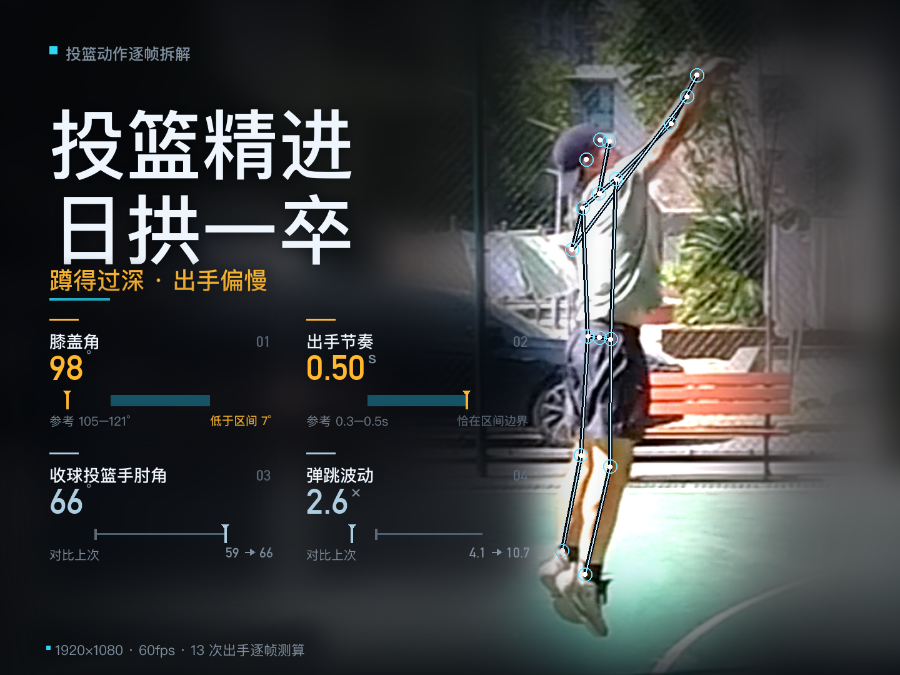
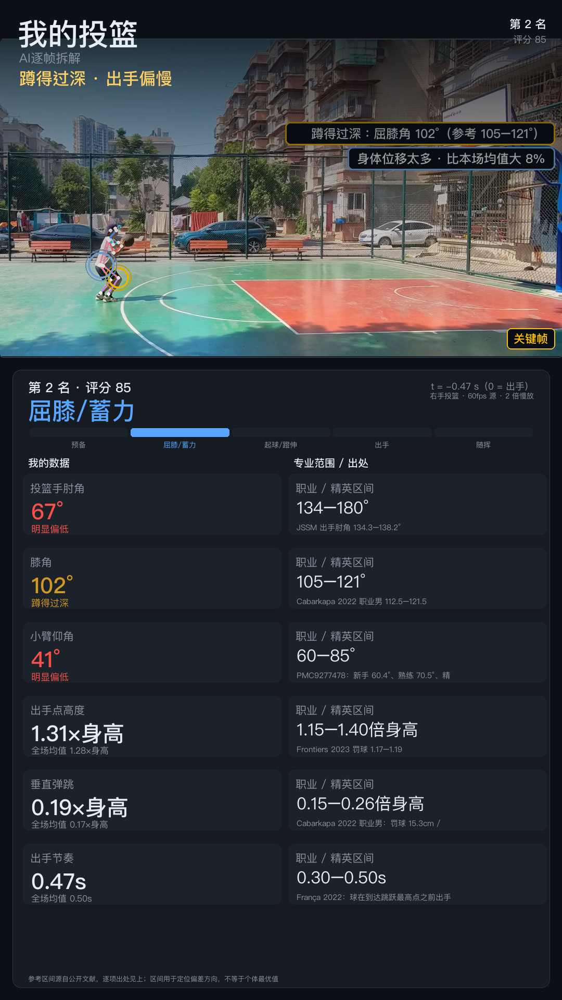
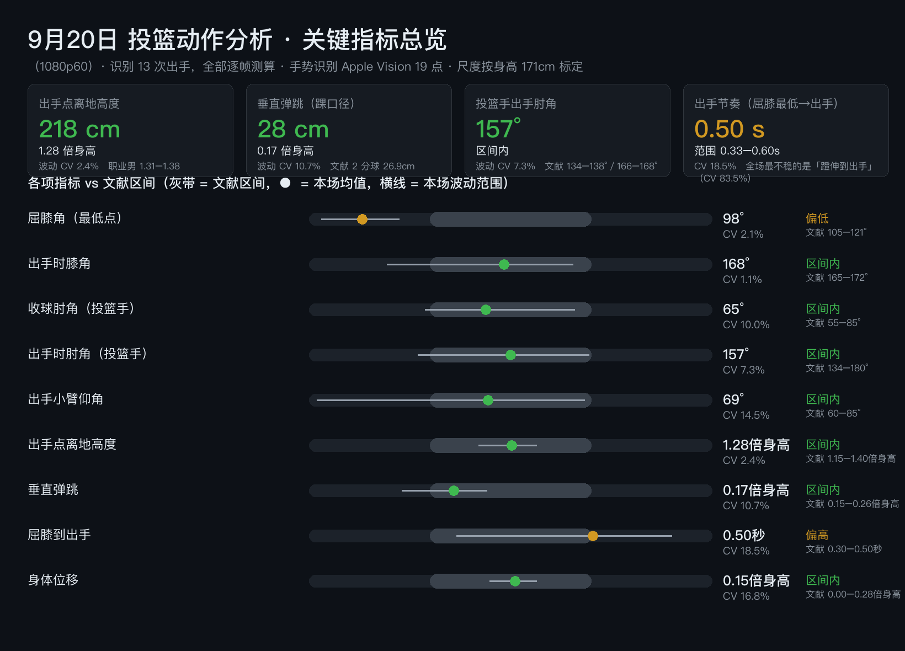
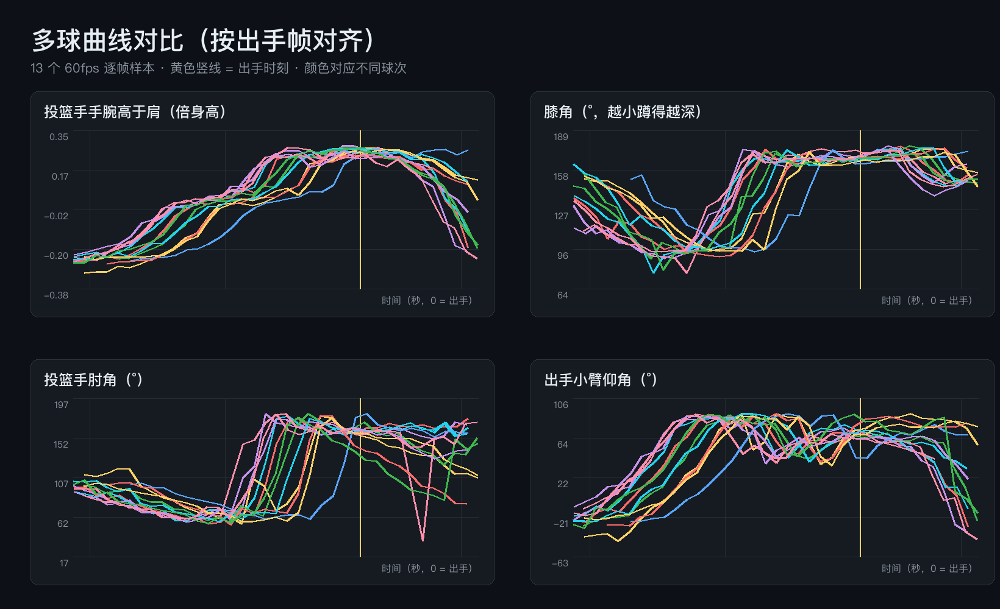

# ShotClib · 投篮视频动作分析流水线



> 用 **macOS 原生**（AVFoundation 解码 + Vision 姿态估计）把自己的投篮视频逐帧拆解，输出 **13 项动作指标 / 球 + 逐帧诊断报告 + 数据面板视频 + 科技风封面**。

**这是什么**：一个「自用优先」的个人投篮复盘工具。拍一段投篮训练视频 → 一条命令 → 拿到每球的屈膝角、出手肘角、小臂仰角、出手点高度、垂直弹跳、节奏、身体位移，以及和文献参考区间的对比和针对性训练处方。

**为什么做它**：自己练球看不出问题。业余球友请不起教练，也没时间一帧帧回看。这套工具把「运动科学文献里的参考区间」和「每球的实测值」对齐，让「蹲得过深 / 弧线偏平」这类问题变成可见的数字。

---

## 核心能力

- **自动定位出手**：粗扫全片，按「手举过肩」事件找到每一次投篮，无需人工标帧。
- **每球 13 项指标**：屈膝角(最低) · 出手时膝角 · 出手时左右肘角 · 收球左右肘角 · 出手小臂仰角 · 出手点离地高度 · 垂直弹跳 · 屈膝到出手 · 膝伸展到出手 · 身体位移 · 落地位移。
- **6 维综合评分**：轨迹直度 25% · 小臂仰角 20% · 投篮手肘角 20% · 屈膝 15% · 出手点 10% · 节奏 10%。
- **文献对照**：每项指标标注参考区间与出处，组内一致性对标新手 / 熟练 / 精英。
- **起球轨迹追踪**：自研黑球追踪，算出「起球是否走直线」。
- **一整套产物**：HTML 逐帧诊断报告、多球曲线对比图、数据面板慢放视频、科技风封面、库里对比页。

---

## 效果预览

> 以下均为工具真实生成的产物：真实投篮画面与逐帧数据叠加。

### 逐帧数据面板 · 骨架 + 球轨迹 + 6 项实时指标



### 关键指标总览 · 13 项指标对标文献参考区间



### 多球曲线对比 · 手腕高度 / 膝角 / 肘角 / 小臂仰角



---

## 环境要求

- **仅 macOS**（依赖 Vision / AVFoundation，Windows / Linux 无法运行）
- Python 3.9+，推荐 3.13

### 安装依赖

```bash
python3 -m pip install numpy Pillow \
  pyobjc-framework-AVFoundation \
  pyobjc-framework-CoreMedia \
  pyobjc-framework-Quartz \
  pyobjc-framework-Vision \
  pyobjc-framework-Cocoa
```

> 工具不要求 ffmpeg / opencv。`shotcli` 会自动探测带依赖的解释器；也可把固定路径写进 `tools/shotcli.json` 的 `python` 字段。

---

## 拍摄要求（很重要）

分析质量取决于拍摄。按重要性排序：

| # | 要求 | 为什么 |
|---|---|---|
| 1 | **侧面 90° 机位**，距球员 3–6m，机位高度在腰部（不俯拍） | 球飞行弧线完整入画，才能测真实出手角 / 球速 |
| 2 | **身体占画面高度 60–70%**（1080p 下约 650–750px） | 人物太小会丢失关节细节 |
| 3 | **1080p 60fps**（最低 30fps） | 出手定位误差从 ±0.03s 降到 ±0.017s |
| 4 | **出手后的球留在画面内**（屈膝→出手→离手→落地，前后各多留 1s） | 球出画就只能用肘角近似，测不了轨迹 |
| 5 | **顺光**、球对着天空或单一背景 | 逆光球变黑影，颜色检测失效 |
| 6 | **固定机位**（三脚架），不摇不移动 | 跨日期对比的前提 |
| 7 | **单人、横屏、贴身短裤** | 路人走动会认错人；宽松长裤遮住膝盖 |

**建议**：同一动作拍 20 次以上（一致性指标才有统计意义）；罚球 / 中距 / 三分分段拍（距离会改变最优出手角与屈膝深度）。

---

## 快速开始

```bash
# 1) 建档：填身高 / 投篮手（身高是像素→cm 的唯一尺度来源，必须填准）
python3 tools/shotcli.py setup

# 2) 自检环境
python3 tools/shotcli.py doctor

# 3) 登记视频（扫目录或单条添加）
python3 tools/shotcli.py init
# 或：python3 tools/shotcli.py add <视频路径> --tag a

# 4) 跑完整流水线（scan → shots → deep → top3 → report → assets → video → cover）
python3 tools/shotcli.py run a

# 5) 看结果
python3 tools/shotcli.py list          # 各阶段完成度
python3 tools/shotcli.py shots a       # 逐球指标表
open <日期>_投篮分析报告.html          # 报告
```

产物按标签输出到 `data/<tag>/`（逐球 json）、`frames/<tag>/`（裁剪帧）、`配图/`（图表）、根目录（报告 HTML）。

---

## 目录结构

```
投篮分析/
├── tools/            # 全部脚本（标准库壳 + pyobjc 重活）
│   ├── shotcli.py    # 主入口 CLI
│   ├── scan.py       # 粗扫（定位出手事件）
│   ├── shots.py      # 精细分析（20fps 逐帧姿态）
│   ├── deep.py       # 深扫（30fps 平滑序列）
│   ├── report.py     # 指标计算 + HTML 报告
│   ├── score_top3.py # 6 维评分 + 全量排名
│   ├── balltrack.py  # 起球轨迹追踪
│   ├── makevid.py    # 数据面板视频
│   ├── makecharts.py # 报告配图
│   ├── cover_tech.py # 科技风封面
│   └── ...
├── data/             # 标签表 + 逐球数据 + 档案（不提交）
├── frames/           # 裁剪帧（不提交）
└── README.md
```

---

## 参考区间来源

指标区间引用自公开文献（Cabarkapa 2022、Frontiers 2023、JSSM、PMC9277478、Okubo & Hubbard 2015 等），完整出处见 `report.py` 的 `REFERENCE` 字典。区间用于**自我横向对比**，非医疗 / 训练建议。

---

## 许可证

MIT License —— 见 [LICENSE](LICENSE)。

## 免责声明

这是一个**个人自用工具**，代码按现状提供。分析结果仅供自我复盘参考，不构成训练或医疗建议。
